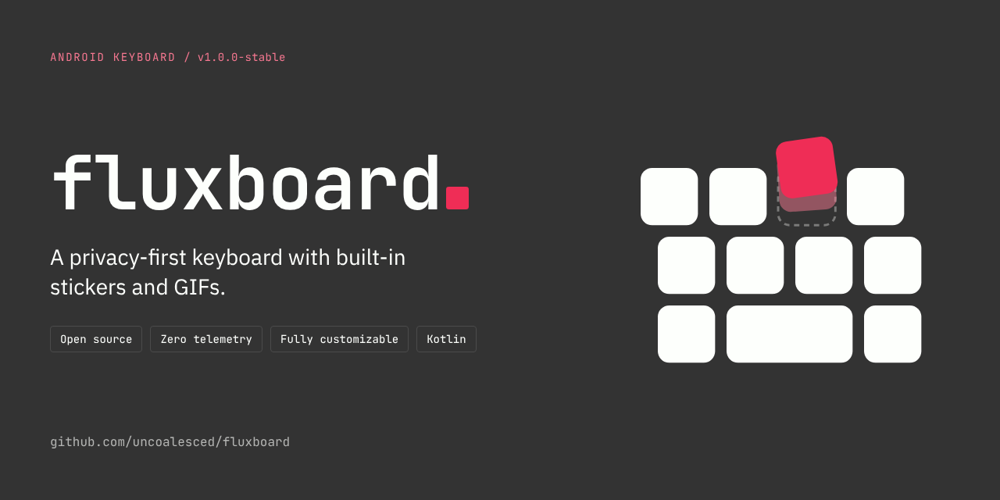

<!-- Engineered by uncoalesced -->
<p align="center">
  
</p>

<p align="center">
  <a href="https://github.com/uncoalesced/fluxboard/releases/latest"></a>
  <a href="https://github.com/uncoalesced/fluxboard/actions/workflows/ci.yml"></a>
  <a href="LICENSE"></a>
  <a href="https://github.com/uncoalesced/fluxboard/stargazers"></a>
  
  
  
</p>

<p align="center">
  <a href="#install">Install</a> ·
  <a href="#what-it-does">Features</a> ·
  <a href="#privacy-you-can-verify">Privacy</a> ·
  <a href="#build-from-source">Build</a> ·
  <a href="#contributing">Contributing</a> ·
  <a href="https://github.com/uncoalesced/fluxboard/issues/new/choose">Report a bug</a>
</p>

---

Your keyboard sees everything: every message, every search, every half-typed thought you deleted before sending. Most keyboards ship that somewhere.

FluxBoard doesn't. It has no analytics, no crash reporter, no ad SDK and no Google Play Services. The dictionary it builds from your typing lives in the app's private storage and goes nowhere else. It is also a keyboard you'll want to use: glide typing, autocorrect that learns you, themes you can edit down to the key, and a sticker studio built in. It is free, open source and needs no account.

<!--
Store screenshots. Add PNGs to fastlane/metadata/android/en-US/images/phoneScreenshots/
(F-Droid and Komi Store both read from there), then uncomment:

<p align="center">
  
  
  
</p>
-->

## Install

v1.0.0-stable needs Android 8.0 (API 26) or newer.

| Source | Status | How to get it |
|---|---|---|
| GitHub Releases | Available | Download `FluxBoard-v1.0.0-stable-release.apk` from the [latest release](https://github.com/uncoalesced/fluxboard/releases/latest) |
| Obtainium | Available | Add `https://github.com/uncoalesced/fluxboard` as an app source |
| Komi Store | Available | Search for FluxBoard, or add `uncoalesced/fluxboard` |
| F-Droid | Planned | Store metadata already lives in [`fastlane/`](fastlane/metadata/android/en-US) |

GitHub, Obtainium and Komi Store all deliver the same signed APK, so they update each other. GitHub shows a SHA-256 digest beside the file if you want to check it. F-Droid builds from source and signs with its own key, so an F-Droid install won't update over one from the other sources, and the reverse.

After installing:

1. Open FluxBoard and follow the setup prompts.
2. Enable it in your phone's keyboard settings.
3. Pick it as your default keyboard when asked.

## What it does

### Typing

- Glide typing that copes with doubled letters, rounded corners and fast swipes. When two words share a path (to and too), the other reading is one tap away in the suggestion strip.
- Autocorrect and next-word prediction run entirely on the device. Corrections are weighted by where the keys actually sit, so "vall" becomes "call", and "dont" becomes "don't".
- Space-bar cursor scrubbing, a text-editing panel, and hold-backspace-then-swipe to delete whole words.
- Long-press any key for its symbols. The digits carry superscripts and fractions, and `4` offers currencies.
- Emoji picker with search, recents and an emoticons tab, clipboard history that only you can clear, and media controls for whatever is playing.

### Making it yours

- Edit every colour, the key shapes, fonts, a background image and the haze behind the keys.
- Remap the layout, including the symbol pages, and add a number row.
- Set height, key size and bottom gap on three separate sliders, or resize straight from the keyboard.
- Haptics with a strength slider, and typing stats (keys and words) that stay on the device.

### Stickers

- Cut a sticker out of a screenshot or photo with crop and a manual eraser, edit it later, sort it into categories and send it from the keyboard.
- Trim a video clip and export it as a GIF or an animated WebP.
- Move your whole library to a new phone over Wi-Fi, paired with a QR code.

## Privacy you can verify

Plenty of apps promise privacy. Two of FluxBoard's biggest claims are enforced by the build, so a regression can't ship quietly.

- Every release APK is unpacked, and its DEX files and R8 mapping are scanned. Any Play Services, ML Kit, Firebase or `datatransport` class fails the build. The check includes a positive control, so a broken scan fails loudly instead of passing.
- The usage log that tester builds keep is absent from release builds as a class, not just switched off by a flag.
- In a password or PIN field, FluxBoard stops learning, suggesting, autocorrecting, glide-decoding and capturing the clipboard. A numeric PIN field gets a digits-only pad. A private-mode switch covers everything else.
- Your personal dictionary and clipboard history are kept out of Android's cloud backup.

The full picture, including every permission and why it exists, is in [PRIVACY.md](docs/PRIVACY.md). See also [SECURITY.md](docs/SECURITY.md) and [TERMS.md](docs/TERMS.md).

## Known limitations in v1.0.0-stable

- No automatic background removal. ML Kit was taken out because it pulls in Play Services and a telemetry transport. Automatic removal will return only with an open, on-device model that ships in this repo.
- Sticker links only work on your own network. The relay that would carry them further is written but not deployed.
- Voice input is a placeholder and says so when you tap it.
- English only, on one QWERTY-family layout (fully remappable).
- Sticker delivery to WhatsApp and Discord is not confirmed on a real device.

Found something rough? [Open an issue](https://github.com/uncoalesced/fluxboard/issues/new/choose).

## Build from source

You need JDK 17+ and the Android SDK for API 36.

```bash
git clone https://github.com/uncoalesced/fluxboard.git
cd fluxboard
./gradlew assembleDebug
```

`./gradlew build` runs the same gate as CI: ktlint, the unit suite across all modules, lint, and the release build with its privacy checks.

Release signing reads a `keystore.properties` at the repo root that points at a keystore kept outside it. Neither is committed. Without the file the release build comes out unsigned instead of failing, so fresh clones, CI and F-Droid just work.

### Packaging details

| | |
|---|---|
| Application ID | `com.uncoalesced.stickykeys` |
| Version | v1.0.0-stable |
| Min / target SDK | 26 (Android 8.0) / 36 |
| License | [MIT](LICENSE) |
| Source tag | Each release is tagged with its version name |
| Store metadata | [`fastlane/metadata/android/en-US`](fastlane/metadata/android/en-US) |
| Language | Kotlin. Python is used only for the offline dictionary, emoji and icon tooling. |

## Under the hood

| Layer | Choice |
|---|---|
| UI | Jetpack Compose, including inside the keyboard itself |
| Architecture | MVVM with unidirectional data flow |
| DI | Hilt (the IME's own ViewModels are built by hand) |
| Persistence | Room for anything queryable, files on disk for sticker bytes |
| Concurrency | Coroutines and Flow |
| Size | About 8 MB installed, with a 100 MB ceiling enforced in CI |

The Gradle modules are `app` (settings and sticker management), `keyboard-core` (the IME, prediction, theming, clipboard), `sticker-core` (data layer and image pipeline), `transfer` (device-to-device migration) and `baselineprofile`. More in [ARCHITECTURE.md](docs/ARCHITECTURE.md).

## Contributing

Contributions are welcome. [CONTRIBUTING.md](docs/CONTRIBUTING.md) covers the build, the house style and the few non-negotiables. The main one: nothing may add telemetry or a Play Services dependency.

Bug reports from real devices are the most useful thing you can send. There are issue templates for general bugs, keyboard problems and feature ideas.

## Standing on shoulders

- [FlorisBoard](https://github.com/florisboard/florisboard), the main reference for building an Android IME, and for its theming and dictionary approach.
- [EweSticker](https://github.com/FredHappyface/Android.EweSticker), prior art for a sticker keyboard and multi-format sticker handling.
- [LocalSend](https://github.com/localsend/localsend), the model for serverless transfer between devices on a network.
- [ZXing](https://github.com/journeyapps/zxing-android-embedded) and [qrcode-kotlin](https://github.com/g0dkar/qrcode-kotlin) for QR pairing. Both are Apache-2.0 and neither needs Play Services.
- SCOWL, whose word lists filter the dictionary corpus so common misspellings don't ship as real words.

## License

[MIT](LICENSE). Copyright 2026 uncoalesced and ZapCannonYT. See [AUTHORS.md](docs/AUTHORS.md).

Using the app is also covered by [TERMS.md](docs/TERMS.md), which mostly repeats the MIT license: no warranty, and you're responsible for what you type.

---

<p align="center">
  <picture>
    <source media="(prefers-color-scheme: dark)" srcset="assets/logos/fluxboard-mark.svg">
    
  </picture>
  <br>
  <sub>FluxBoard v1.0.0-stable</sub>
</p>
